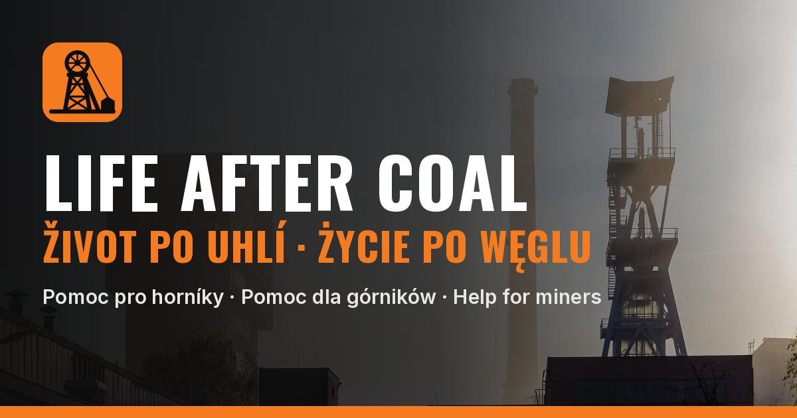

# Life After Coal · Život po uhlí · Życie po węglu

Every support programme for coal miners and their families in **Czech and Polish Silesia**, in one place. A miner answers a few questions and sees what applies to them, what does not and why, and what to do next, in Czech, Polish or English.

**Live site:** <https://ondrejmarvan.github.io/life-after-coal/>

Built for the Club Alpbach Design Thinking Hackathon, "Life Beyond Coal" challenge.



## Contents

1. [What the site does](#what-the-site-does)
2. [Try it: demo accounts](#try-it-demo-accounts)
3. [Demo mode and connected mode](#demo-mode-and-connected-mode)
4. [Run it on your computer](#run-it-on-your-computer)
5. [Publish it](#publish-it)
6. [Content and data](#content-and-data)
7. [Keeping the data current](#keeping-the-data-current)
8. [How to change things](#how-to-change-things)
9. [Project structure](#project-structure)
10. [Design and accessibility](#design-and-accessibility)
11. [Testing with real users](#testing-with-real-users)
12. [Known gaps](#known-gaps)
13. [Credits and licences](#credits-and-licences)

## What the site does

| Feature | Where in the code |
|---|---|
| **"Check what you can get" wizard**: 9 questions, then results grouped as likely / check / not for you, each with the reason. Builds a personal route with a mine-lift progress bar, the Czech 6-month allowance countdown and an allowance estimate. | `src/pages/Check.tsx`, rules in `src/data/rules.ts` |
| **Programme directory**: 76 programmes and local measures (44 Poland, 31 Czechia, 1 cross-border) with filters, evidence badges ("verified", "reported") and last-checked dates. Every field is in Czech, Polish and English. | `src/pages/Programmes.tsx`, `src/pages/Programme.tsx` |
| **Apply online or in person**: each programme page lists the official link, contacts and the nearest help points. | Programme page sidebar |
| **Map** of help points, mines and events (Leaflet + OpenStreetMap). | `src/pages/MapPage.tsx`, `src/data/places.ts` |
| **Calendar** of deadlines, law changes and mine milestones, with `.ics` download. | `src/pages/Calendar.tsx`, `src/data/events.ts` |
| **"Need to talk?"**: official helplines and a callback form. | `src/pages/Hotline.tsx` |
| **Stories and history**: timeline of past closures in both countries, lessons learned, **12 mining facts**, moderated personal stories. | `src/pages/Stories.tsx`, `src/data/site.json`, `src/data/facts.ts` |
| **"Did you know?"** on the home page: three facts a day, rotating. | `src/pages/Home.tsx` |
| **AI assistant** that answers only from the programme database and cites the cards it used (keyword search where no AI server is available). | `src/pages/Assistant.tsx`, `api/assistant.ts` |
| **Accounts and dashboard**: saved programmes, personal route, deadlines, application tracker. | `src/pages/Account.tsx`, `src/lib/auth.tsx` |
| **Admin**: edit programmes and translations, CSV/JSON import, events, callbacks, subscribers, newsletter digest, moderation, a "needs re-check" list, suggestions. | `src/pages/Admin.tsx` |
| **Official portals**, a list of things mentioned in the research but not confirmed, and a **"Not covered?"** page with exclusion tables. | `src/pages/Portals.tsx`, `src/pages/Gaps.tsx` |
| Forum, newsletter (with printable A4 digest), help for children, "Buy us a coffee" page. | `src/pages/Forum*.tsx`, `Newsletter.tsx`, `Digest.tsx`, `Children.tsx`, `Support.tsx` |
| **Photo credits** for every photo on the site. | `src/pages/Credits.tsx`, `src/data/photos.ts` |

## Try it: demo accounts

The live site runs in demo mode (see below), so accounts live in your browser. Two accounts are built in:

| Account | Email | Password | What you see |
|---|---|---|---|
| Demo miner (Petr Novák) | `demo@lifeaftercoal.example` | `Sachta-2026` | A dashboard filled with sample data: an OKD underground miner who left on 31 Oct 2026, with a route (2 of 6 steps done), the 6-month allowance deadline (30 Apr 2027), three tracked applications and three saved programmes. |
| Admin | `admin@lifeaftercoal.example` | `Lampa-Admin-2026` | Everything above plus the **Admin** menu: edit programmes, translations, events, moderation and so on. |

- The sign-in page also has a **"Try the demo account"** button that signs in as the demo miner without typing anything.
- Only the admin account opens `/admin`. Accounts made with "Create account" are ordinary users.
- Wrong passwords are rejected and an email can only be registered once, as on a real site.
- Everything is stored in **this browser only** (localStorage). Clearing site data resets it. The sample data is added the first time the demo miner signs in on a browser.
- These are demo credentials for a site without a backend. They are not secret and protect nothing. In connected mode (Supabase) they do not exist; real accounts are used instead.

## Demo mode and connected mode

The site has two modes, chosen automatically.

| | **Demo mode** (no configuration; the live GitHub Pages site) | **Connected mode** (Supabase configured) |
|---|---|---|
| Programmes, map, calendar, wizard, facts | Work fully | Work fully, and admin edits are shared |
| Accounts | Built-in demo accounts and local accounts, per browser | Real accounts with email confirmation and sign-in links |
| Forum, stories, newsletter, suggestions | Saved in the visitor's browser only | Saved in the database, visible to admins |
| Callback form ("Need to talk?") | Replaced by a notice pointing to the official lines | Requests reach the admin "Callbacks" tab |
| AI assistant | Keyword search of the programme database | Real AI answers if hosted on Vercel with an API key |

A thin banner at the top says when the site runs in demo mode.

## Run it on your computer

You need **Node.js 24** (the system Node 18 on this machine is too old; use nvm).

```bash
. ~/.nvm/nvm.sh        # loads Node 24
npm install
npm run dev            # http://localhost:5173
```

Other commands:

```bash
npm run build          # type-check and build into dist/
npm run lint           # oxlint
npm run preview        # serve the built site
```

To try the GitHub Pages build exactly as it is published (served under `/life-after-coal/`):

```bash
BASE_PATH=/life-after-coal/ npm run build && npx vite preview   # http://localhost:4173/life-after-coal/
```

## Publish it

### GitHub Pages (current, free)

`.github/workflows/pages.yml` builds the site and publishes it on **every push to `main`**. Pushing to `main` therefore changes the live site.

- One-time setup (already done): GitHub repo → Settings → Pages → Source: **GitHub Actions**.
- Deep links such as `/check` work because the workflow copies `index.html` to `404.html`.
- **Link previews**: `index.html` has Open Graph tags and `public/og-image.jpg` (1200×630), so links shared on Facebook, WhatsApp, Messenger or LinkedIn show the photo, title and description. Facebook caches previews; after changing them, use <https://developers.facebook.com/tools/debug/> and click "Scrape again".

### Hosting the AI assistant (Vercel)

GitHub Pages only serves files, so the assistant there falls back to keyword search. For real AI answers, host the same repository on Vercel, which runs `api/assistant.ts` as a server function:

1. Create a free account at <https://vercel.com> (sign in with GitHub).
2. **Add New → Project**, import `life-after-coal`. Framework preset: **Vite**. Leave the build settings as they are.
3. Get a Gemini API key in Google AI Studio (<https://aistudio.google.com>, **Get API key**) and turn on billing for its Google Cloud project. Gemini's terms allow only the paid tier for apps used in the EU, and only on the paid tier are questions kept out of Google's model training. In Google Cloud **Billing → Budgets & alerts**, set a monthly budget so you get an e-mail before costs grow (a budget alerts, it does not stop spending).
4. In the Vercel project: **Settings → Environment Variables**, add `GEMINI_API_KEY`. Optionally add `GEMINI_MODEL` (default `gemini-3.1-flash-lite`, the cheapest stable Gemini model: about $0.25 per million input and $1.50 per million output tokens, roughly $0.002 per question).
5. **Deploy.** The site appears at `https://<project>.vercel.app`, with the assistant working. Every push to `main` redeploys it too.

`vercel.json` sends every path except `/api/...` to the single-page app. The API key stays on the server; it is never sent to the browser. You can keep GitHub Pages as well, or point people to the Vercel address only.

### Connecting a database (optional, Supabase)

For shared data and real accounts:

1. Create a project at <https://supabase.com>. In the SQL editor run `supabase/migrations/0001_init.sql` (tables and row-level security).
2. Add `VITE_SUPABASE_URL` and `VITE_SUPABASE_ANON_KEY` (Project settings → API):
   - GitHub Pages: repo → Settings → Secrets and variables → Actions → **Variables**.
   - Vercel: project → Settings → Environment Variables.
3. Make yourself an admin after signing up once:
   ```sql
   update public.profiles set is_admin = true
   where id = (select id from auth.users where email = 'you@example.com');
   ```

## Content and data

| File | What it holds |
|---|---|
| `src/data/programmes.json` | 76 programmes. English source fields (`intro`, `who_for`, `what_you_get`, `conditions`, `how_to_apply`, `dates`, `legal_basis`, …), short `summary` in cs/pl/en, and full Czech and Polish translations in `i18n.cs` / `i18n.pl`. Also wizard tags: `needs`, `groups`, `employers`, `regions`, `status`, `evidence`. |
| `src/data/site.json` | Stories timeline (`history`), lessons (`historyLessons`), the exclusion matrices for the Gaps page (`exclusions`), official portals (`portals`) and items that were mentioned but not confirmed (`notFound`). Each item has an `i18n` object with its Czech and Polish text. |
| `src/data/facts.ts` | The 12 "Did you know?" facts in three languages, each with a source link and a photo or a key-figure band. |
| `src/data/photos.ts` | The photo registry: files, alt text in three languages, crop position, author and licence. |
| `src/data/events.ts`, `places.ts`, `rules.ts` | Calendar events, map points (approximate coordinates, marked so), wizard rules. |
| `src/i18n/cs.ts`, `pl.ts`, `en.ts` | Every interface text. TypeScript checks that all three languages have the same keys. |

**Where the content comes from.** `programmes.json` and `site.json` were built from two research databases dated 14 Nov 2026 ("Support for coal miners in Poland/Czechia: programme database"). Wizard tags and summaries were added by hand. The Czech and Polish translations keep law names, office names, amounts, dates, phone numbers, emails and URLs exactly as in the source; a script checked that every number, email and URL survived translation.

**Corrections made on 15 Nov 2026:** the PL-N13 dates text no longer stops mid-sentence; "NÚK" is now NKÚ (the Czech Supreme Audit Office); the resolved "Contents of FESL 10.21" item was removed from the not-found list; the first timeline event now matches the programme pages (leave for underground and processing staff, severance for other staff, paid out by the companies from a state subsidy).

**Nothing here is legal or financial advice.** Every programme page shows how well its information is verified and when it was last checked.

## Keeping the data current

Programmes change: calls open and close, laws get amended, deadlines pass. A stale benefits site does harm, so do this **once a month** (about one hour):

1. Sign in as admin and open **Admin → Needs re-check**. It lists programmes not checked for 90 days, not yet verified, or with an unclear status.
2. For each, open the official link and check: status (open / closed), amounts, deadlines, contacts.
3. Edit the programme in **Admin → Programmes** and update both the English field and its Czech and Polish translations. Click **Mark as checked**; this sets today's date.
4. Look at **Calendar**: remove or update events that have passed, add new calls and deadlines.
5. Check the "Mentioned but not confirmed" list on the Portals page: has anything been confirmed?
6. In demo mode admin edits stay in your browser. To publish a change, make the same edit in `src/data/programmes.json` and push to `main` (**Admin → Programmes → Export CSV** gives you the edited data to copy from).

Dates to watch right now: **Úvěr Transformace** (NRB loan) applications close **31 Dec 2026**; the **ČSM shafts** start being filled in Dec 2026; FESL **10.19** outplacement projects are due to be chosen in Nov 2026.

## How to change things

- **A programme**: edit `src/data/programmes.json` (or use Admin, see above). If you change an English field, update `i18n.cs` and `i18n.pl` too; the page shows the English text where a translation is missing.
- **Interface text**: `src/i18n/en.ts`, `cs.ts`, `pl.ts`. Add the same key to all three.
- **A fact**: add an entry to `src/data/facts.ts` with text in three languages, a `source` link and either a `photo` or a `highlight`.
- **A photo**:
  1. Use photos you have the rights to, for example from Wikimedia Commons under CC BY or CC BY-SA. Note the author, licence and file page.
  2. Convert to WebP in two widths (e.g. 800 and 1600 px), put them in `src/assets/photos/`.
  3. Import them in `src/data/photos.ts` and fill in `alt` (three languages), `position` and `credit`.
  4. Use it: `<PageHeader photo="yourKey" …>` for a page header, or `photo: 'yourKey'` on a fact. It appears on `/credits` automatically.
- **The logo**: `src/components/Headframe.tsx` (in the page) and `public/favicon.svg` (browser tab) are the same flat drawing; change both.
- **The share-preview image**: replace `public/og-image.jpg` (1200×630 JPEG).
- **A map point or event**: `src/data/places.ts`, `src/data/events.ts`.

## Project structure

```
api/assistant.ts            Vercel server function for the AI assistant
docs/usability-test.md      20-minute usability test kit (Czech and Polish task cards)
public/                     favicon.svg, og-image.jpg (link previews)
src/assets/photos/          WebP photos (credits in src/data/photos.ts)
src/components/             Layout (header, menu, footer), shared UI, Headframe logo
src/data/                   programmes, site content, facts, photos, events, places, wizard rules, types
src/i18n/                   Czech, Polish and English interface texts
src/lib/                    data layer (Supabase or browser storage), auth and demo accounts, content helpers, search
src/pages/                  one file per page
supabase/migrations/        database schema and row-level security
.github/workflows/pages.yml GitHub Pages deploy
vercel.json                 Vercel routing
```

Stack: React 19, Vite, TypeScript, Tailwind CSS 4, react-router 7, i18next, Leaflet, Supabase (optional).

## Design and accessibility

- **Look**: black and orange, the kit-stripe pattern from safety clothing, yellow-black safety tape for warnings, a flat headframe logo, real photos of mines in both countries.
- **Fonts**: Oswald for headings (industrial, condensed), Inter for text. Both bundled with full Czech and Polish characters. Body text is 18px.
- **Language**: plain, short sentences. Polish uses the informal "ty", Czech the polite "vy", as is usual on public-service sites in each country.
- **Accessibility**: skip-to-content link, every page has its own browser-tab title, photos have alt text in three languages, large touch targets, works at 375px phone width without sideways scrolling.
- **Print**: programme pages, the wizard route and the newsletter digest print cleanly on A4.

## Testing with real users

`docs/usability-test.md` is a ready-to-use kit for 20-minute sessions with 2–3 miners or family members: what to say (in Czech and Polish), five tasks, a 1–7 ease score, closing questions and a printable notes sheet. Run it before the final pitch; three real quotes are worth more than any slide.

## Known gaps

- Demo mode only: forms and accounts stay in each visitor's browser. Connect Supabase to make them shared and real.
- The AI assistant needs Vercel and an API key; on GitHub Pages it is keyword search.
- Map coordinates are approximate.
- Some programmes are "reported" rather than "verified"; their pages say so.
- No payment method is connected to "Buy us a coffee".

## Credits and licences

- **Photos**: Wikimedia Commons, by Tadeáš Bednarz, Mikepascoe, Nemo5576, Marta Malina Moraczewska, Pawelsuder, Palickap, Boris Renner and Jim Heaphy (Cullen328), under CC BY-SA 3.0 / 4.0. They were resized and some cropped; the edited versions are under the same licences. Full list with links on the site's [Photo credits](https://ondrejmarvan.github.io/life-after-coal/credits) page.
- **Map data**: © OpenStreetMap contributors.
- **Facts**: each links to its source on the site.
- **Logo**: drawn for this site.
- **Code**: no licence has been chosen yet; all rights reserved until one is added.
